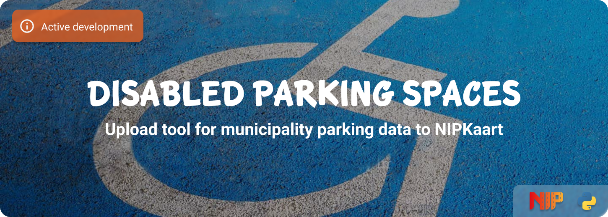

<!-- Banner -->


<!-- PROJECT SHIELDS -->
[![GitHub Activity][commits-shield]][commits]
[![GitHub Last Commit][last-commit-shield]][commits]
[![Linting][linting-shield]][linting-url]

[![License][license-shield]](LICENSE)
[![Contributors][contributors-shield]][contributors-url]

[![Forks][forks-shield]][forks-url]
[![Stargazers][stars-shield]][stars-url]
[![Issues][issues-shield]][issues-url]

Collect municipal accessible-parking data for [NIPKaart](https://nipkaart.nl). One container collects Amsterdam (`nl-amsterdam`), Arnhem (`nl-arnhem`), Eindhoven (`nl-eindhoven`), Namur (`be-namur`), Antwerpen (`be-antwerpen`), Stockholm (`se-stockholm`) Groningen (`nl-groningen`) and Köln (`de-koeln`) and uploads complete deliveries to private Cloudflare R2 for review in core.

## Run

Copy `.env.example` to `.env`, fill in the private R2 bucket endpoint and credentials, set `STOCKHOLM_API_KEY` from [Stockholm key registration](https://openparking.stockholm.se/Home/Key), then start:

```bash
chmod 600 .env
docker compose up -d --build
docker compose logs --tail 100 -f collector
```

Each dataset runs daily and retries failures independently. Set `COLLECTOR_INTERVAL_SECONDS` to change the interval. Keep the data volume during updates: **do not use `docker compose down -v`**, which deletes pending deliveries.

## Local export

Requires Python 3.14+ and [uv](https://docs.astral.sh/uv/). No R2 credentials needed.

```bash
uv sync --locked
uv run python export.py --city amsterdam --output /tmp/amsterdam.json
uv run python export.py --city eindhoven --output /tmp/eindhoven.json
uv run python export.py --city namur --output /tmp/namur.json
uv run python export.py --city antwerpen --output /tmp/antwerpen.json
uv run python export.py --city groningen --output /tmp/groningen.json
uv run python export.py --city koeln --output /tmp/koeln.json
uv run python export.py --city ndw --output /tmp/ndw-e6.json
# With STOCKHOLM_API_KEY set in the process environment:
uv run python export.py --city stockholm --output /tmp/stockholm.json
```

Exports are for source review; publication requires approval in core. See the [collector documentation](docs/collector.md) for source selections and limitations.

### NDW location proposal delivery

NDW is an explicit run. In a configured collector environment, `uv run python collector.py --city ndw --directory /data` uses the private `proposals/` prefix and retains the exact pending file on upload failure. The default municipal schedule excludes NDW while [Core intake](https://github.com/NIPKaart/core/issues/1486) is being built.

The NDW current-state API returns the national placed E6 selection in one response. It supplied no independent record total in the live check. The collector checks the complete response, unique IDs and the count before delivery, and holds drops over 20% against its last acknowledged snapshot. It retains typed under-sign evidence and omits all raw under-sign text. See [ADR 0015](https://github.com/NIPKaart/core/blob/main/docs/adr/0015-ingest-location-proposal-sources.md).

## Development

Register municipal datasets in [`app/datasets.py`](app/datasets.py). Each source returns a shared `Collection`; the exporter and scheduler use the registry automatically. Register location proposal sources in [`app/proposals/__init__.py`](app/proposals/__init__.py) and keep their implementations in the corresponding country package.

```bash
uv run python -m unittest discover -s tests -v
uv run pre-commit run --all-files
```

See the [collector documentation](docs/collector.md) for package responsibilities, source limitations and R2 retention, and the [core delivery contract](https://github.com/NIPKaart/core/blob/main/docs/development/data-import-contract.md) for mappings, registration and review requirements.

## Contributing

Report bugs or propose a new source through [GitHub issues][issues-url]. For code changes, run the development checks above and open a pull request.

## License

[MIT](LICENSE)

<!-- MARKDOWN LINKS & IMAGES -->
[contributors-shield]: https://img.shields.io/github/contributors/nipkaart/disabled-parking.svg
[contributors-url]: https://github.com/nipkaart/disabled-parking/graphs/contributors
[forks-shield]: https://img.shields.io/github/forks/nipkaart/disabled-parking.svg
[forks-url]: https://github.com/nipkaart/disabled-parking/network/members
[stars-shield]: https://img.shields.io/github/stars/nipkaart/disabled-parking.svg
[stars-url]: https://github.com/nipkaart/disabled-parking/stargazers
[issues-shield]: https://img.shields.io/github/issues/nipkaart/disabled-parking.svg
[issues-url]: https://github.com/nipkaart/disabled-parking/issues
[license-shield]: https://img.shields.io/github/license/nipkaart/disabled-parking.svg
[commits-shield]: https://img.shields.io/github/commit-activity/y/nipkaart/disabled-parking.svg
[commits]: https://github.com/nipkaart/disabled-parking/commits/main
[last-commit-shield]: https://img.shields.io/github/last-commit/nipkaart/disabled-parking.svg
[linting-shield]: https://github.com/nipkaart/disabled-parking/actions/workflows/linting.yaml/badge.svg
[linting-url]: https://github.com/nipkaart/disabled-parking/actions/workflows/linting.yaml
